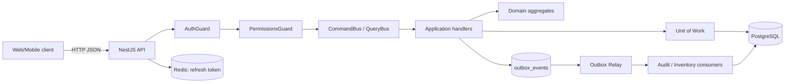
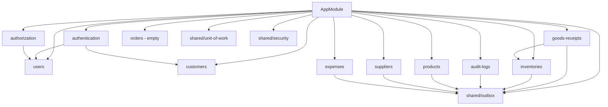
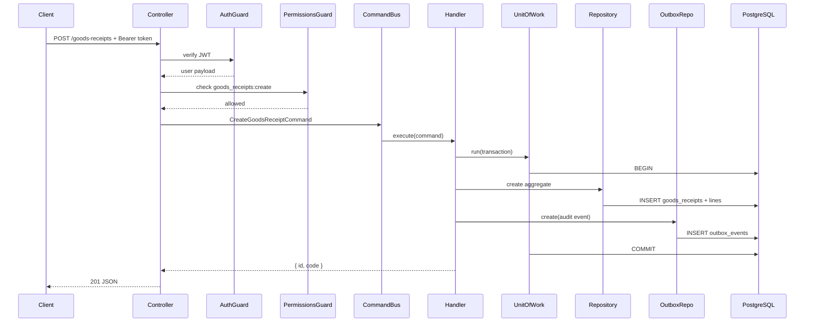
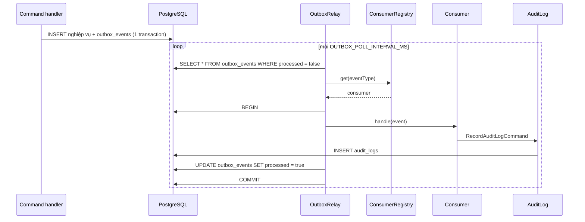

# Kiến trúc hệ thống

## 1. Tổng quan

Backend là một **modular monolith** dùng NestJS, tổ chức theo **CQRS** và
**Clean Architecture**. Mỗi module nghiệp vụ tự chứa domain, application,
infrastructure và presentation; giao tiếp qua command/query bus và outbox event.



Thành phần ngoài:

| Thành phần | Vai trò | Trạng thái |
|---|---|---|
| PostgreSQL 18 | Dữ liệu nghiệp vụ, outbox, audit | ✅ |
| Redis 8 | Refresh token, AOF bật | ✅ |
| PSP (VNPay/MoMo) | Thanh toán | ⬜ thiết kế |
| Đơn vị vận chuyển | Giao hàng | ⬜ thiết kế |
| Email/SMS | Thông báo | ⬜ |

## 2. Phân lớp

```
presentation  → HTTP, DTO, guard, map request
application   → command/query handler, port, read model
domain        → aggregate, value object, enum, repository interface, event
infrastructure→ MikroORM entity, repository impl, mapper, adapter
```

Quy tắc phụ thuộc:

- `domain` không import NestJS ORM/HTTP (chỉ dùng exception của Nest ở một số
  aggregate để thống nhất lỗi nghiệp vụ).
- `application` phụ thuộc `domain` + port, không phụ thuộc MikroORM.
- `infrastructure` hiện thực port, là nơi duy nhất biết `Mikro*`.
- `presentation` không gọi repository trực tiếp, chỉ dùng bus.

## 3. Bản đồ module



| Module | Trách nhiệm |
|---|---|
| `authentication` | Account, mật khẩu, JWT, refresh token |
| `authorization` | Role, permission, kiểm tra quyền |
| `users` | Người dùng nội bộ |
| `customers` | Hồ sơ khách hàng |
| `products` | Danh mục sản phẩm |
| `suppliers` | Nhà cung cấp |
| `goods-receipts` | Phiếu nhập, dòng phiếu, xác nhận/huỷ |
| `inventories` | Lô, tồn kho, xuất kho, kiểm kê, consumer nhập kho |
| `orders` | Đơn hàng (chưa triển khai) |
| `expenses` | Chi phí vận hành |
| `audit-logs` | Ghi và tra cứu audit |
| `shared/outbox` | Ghi event, relay, registry consumer |
| `shared/unit-of-work` | Bọc transaction |
| `shared/security` | Guard, decorator actor/permission |

## 4. Luồng xử lý một request ghi

Ví dụ `POST /api/goods-receipts`:



Điểm quan trọng:

- **Transaction boundary nằm ở handler**, không ở controller.
- Outbox event được ghi **cùng transaction** với dữ liệu nghiệp vụ.
- Handler trả read model tối thiểu (`{ id }`, `{ id, code }`), không trả aggregate.

## 5. Outbox và audit



Đặc tính:

- **At-least-once**: event có thể được xử lý lại nếu commit thất bại.
- **Idempotent consumer**: ví dụ nhập kho dùng `batchId` sinh trước; nếu replay,
  batch đã tồn tại thì bỏ qua.
- **Retry có giới hạn**: ghi `attempts`, `last_error`, `failed_at`; sau
  `OUTBOX_MAX_ATTEMPTS` thì dừng và log lỗi.
- **Không có consumer**: relay log cảnh báo, event vẫn pending.
- **Bật/tắt**: `OUTBOX_RELAY_ENABLED=true` mới chạy. Mặc định trong
  `.env.example` là `false`.

Event đang được audit:

```
role.created, permission.granted, role.renamed, permission.revoked,
role.super_admin_set, account.signed_up, account.signed_in,
user.created, user.email_changed, user.role_assigned, user.role_removed,
product.created, supplier.created/updated/activated/deactivated,
goods_receipt.created/confirmed/cancelled,
inventory.stock_issued, inventory.stock_reconciled, expense.created
```

## 6. Xác thực và phân quyền

### Đăng nhập

1. `POST /api/authentication/login` kiểm tra email + Argon2id.
2. Phát access token (JWT, 15 phút) và refresh token (7 ngày).
3. Refresh token lưu Redis, gửi qua cookie `httpOnly`.
4. Client gửi access token ở header `Authorization: Bearer ...`.
5. `POST /api/authentication/refresh` đọc cookie, xoay token, trả access mới.

### Guard

- `AuthGuard`: verify JWT, gắn payload vào `request.user`.
- `PermissionsGuard`: đọc permission yêu cầu từ metadata, query role của user,
  kiểm tra khớp. Super Admin bỏ qua.
- `@ActorContext()`: gom `actorId`, `email`, IP, user-agent để đưa vào event.

### Mô hình quyền

```
users.role_ids[] ──> roles.permissions[] ──> permission catalog
                         └── is_super_admin
```

Role/permission lưu dạng mảng text; kiểm tra bằng hàm thuần trong domain, không
phụ thuộc DB.

## 7. Dữ liệu và transaction

| Chủ đề | Quyết định |
|---|---|
| Tiền | `bigint` VND, value object `Money`/`UnitPrice`/`UnitCost` |
| ID | UUID v4, sinh ở domain (`Id.generate`) |
| Optimistic lock | `roles.version`; các aggregate khác chưa dùng |
| Pessimistic lock | `SELECT ... FOR UPDATE` khi xuất/kiểm kê kho |
| Tồn kho | Nguồn sự thật là `batches`; `inventories` là view |
| Hạn dùng | `date` cho `expires_at` |
| Audit | Append-only, chỉ INSERT qua consumer |
| Outbox | Cùng DB, cùng transaction với nghiệp vụ |

## 8. Cấu trúc thư mục

```
backend/src/
├── modules/
│   ├── authentication/
│   │   ├── application/commands|ports
│   │   ├── domain/
│   │   ├── infrastructure/entities|repositories|mappers|adapters
│   │   └── presentation/authentication
│   ├── authorization/
│   ├── users/
│   ├── customers/
│   ├── products/
│   ├── suppliers/
│   ├── goods-receipts/
│   ├── inventories/
│   ├── orders/                # module rỗng
│   ├── expenses/
│   └── audit-logs/
├── shared/
│   ├── modules/outbox/
│   ├── modules/security/
│   ├── modules/unit-of-work/
│   ├── types/
│   └── value-objects/
├── migrations/
├── app.module.ts
└── main.ts
```

## 9. Quyết định kiến trúc

| # | Quyết định | Lý do | Đánh đổi |
|---|---|---|---|
| ADR-01 | Modular monolith thay vì microservice | Phạm vi đồ án, transaction đơn giản | Khó scale độc lập từng module |
| ADR-02 | CQRS nhẹ (command/query bus), không event sourcing | Đủ tách đọc/ghi, ít phức tạp | Read model phải viết tay |
| ADR-03 | Outbox trong PostgreSQL | Không cần message broker, đảm bảo atomic | Relay polling, độ trễ ~1s |
| ADR-04 | Domain không phụ thuộc ORM | Test nhanh, dễ thay hạ tầng | Phải viết mapper thủ công |
| ADR-05 | `bigint` VND | Chính xác tuyệt đối | Phải convert string ở API |
| ADR-06 | Một nhà thuốc, không multi-tenant | Đúng phạm vi | Không tái sử dụng cho SaaS |
| ADR-07 | Permission dạng chuỗi trong mảng | Đơn giản, dễ kiểm tra | Không có FK, cần validate catalog |
| ADR-08 | Refresh token ở Redis | Thu hồi được, không stateless hoàn toàn | Phụ thuộc Redis |

## 10. Điểm mở rộng

- Thêm module mới: tạo `domain` + `application` + `infrastructure` +
  `presentation`, đăng ký repository token trong module.
- Thêm event: khai báo event type, ghi outbox trong handler, đăng ký consumer
  trong `onModuleInit`.
- Thêm audit: thêm event type vào `AUDITED_EVENT_ACTIONS`.
- Thêm permission: khai báo trong `PERMISSIONS`; guard tự nhận.
- Thêm read model: query handler trả DTO, không trả aggregate.

## 11. Khoảng trống đã biết

| Khoảng trống | Ảnh hưởng |
|---|---|
| `orders` rỗng | Chưa có luồng mua hàng end-to-end |
| `customers` thiếu hồ sơ/địa chỉ | Không giao hàng được |
| `products` thiếu SKU/category/unit | Khó quản lý và lọc |
| Không có API đọc tồn kho/lô | Không xem được tồn qua HTTP |
| Chưa có API duyệt/chi phí | Nghiệp vụ chi phí chưa hoàn chỉnh |
| Outbox relay chạy trong API process | Không phù hợp khi scale ngang |
| Không có rate limit/health check | Thiếu lớp bảo vệ vận hành |
| `products.quantity` trùng lặp với `batches` | Nguy cơ lệch số liệu |
