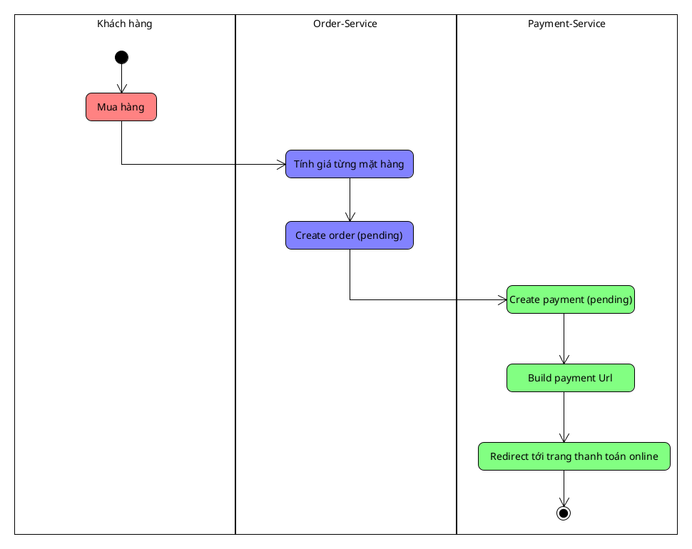
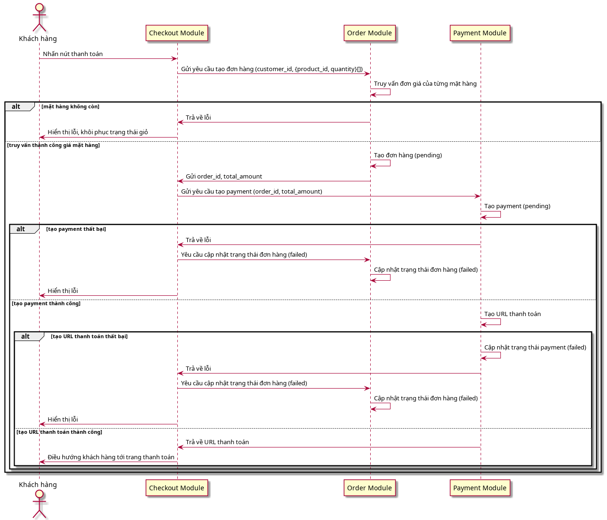

# Checkout Lifecycle

Checkout là hành động khách hàng chốt thanh toán, từ lúc mở trang
thanh toán đến khi redirect sang provider. Toàn bộ phần provider trả
kết quả (return URL, IPN, verify chữ ký, trạng thái payment) nằm ở
payment-lifecycle.md.

## Flow

Activity diagram mô tả happy path của 1 flow checkout

Đầu tiên, hệ thống gửi giỏ hàng tới Order Module (chỉ truyền
customer_id, product_id và quantity). Backend tự tính đơn giá bằng cách 
truy vấn thông tin từng mặt hàng trong giỏ

Tiếp theo, Order Module tạo đơn hàng với trạng thái `pending` và tự
tính total_amount.

Sau đó, Order Module gửi order_id và total_amount cho Payment Module.
Payment Module tạo payment với trạng thái `pending`, build URL thanh toán
và redirect khách hàng tới trang thanh toán của provider (VNPay, MoMo).

## Sequence diagram

Sequence diagram mô tả chi tiết flow checkout, bao gồm cả edge case như
mặt hàng không còn, tạo payment thất bại, tạo URL thanh toán online thất bại 

