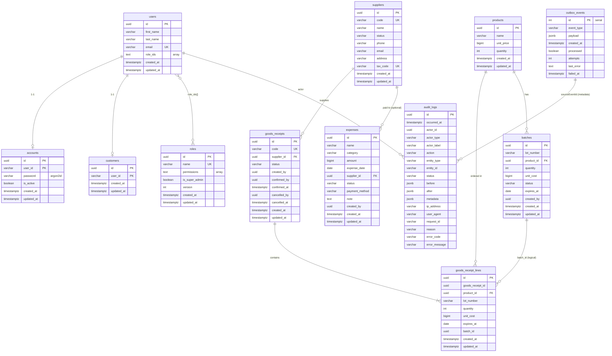
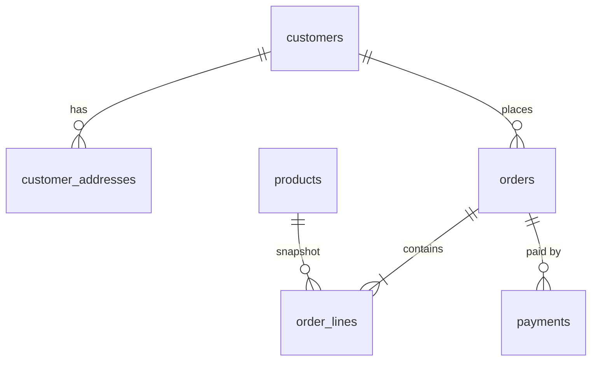

# Data model

## 1. Nguyên tắc

- Mỗi bảng có khóa chính; hầu hết dùng UUID v4 sinh từ domain.
- Thời gian lưu `timestamptz`; ngày nghiệp vụ (hạn dùng, ngày chi phí) dùng
  `date`.
- Tiền lưu `bigint` (VND), không dùng `numeric`/float sau migration
  `Migration20261114000000_money_to_bigint`.
- Không xoá cứng dữ liệu nghiệp vụ quan trọng; dùng trạng thái (`inactive`,
  `cancelled`) hoặc bảng audit.
- `audit_logs` là **append-only**.
- `outbox_events` nằm cùng DB để ghi atomic với nghiệp vụ.
- Sai khác giữa domain và DB được xử lý ở domain; DB giữ ràng buộc tối thiểu.

## 2. ERD hiện tại



> `batches` → `goods_receipt_lines.batch_id` là quan hệ logic, **không có FK**
> trong DB. `users` → `roles` cũng là quan hệ logic qua mảng `role_ids`.

## 3. Mô tả bảng

### `users`

Người dùng nội bộ và chủ tài khoản khách hàng.

| Cột | Kiểu | Ghi chú |
|---|---|---|
| `id` | uuid PK | |
| `first_name`, `last_name` | varchar | |
| `email` | varchar unique | Đăng nhập |
| `role_ids` | text[] | GIN index; không FK |
| `created_at`, `updated_at` | timestamptz | |

### `accounts`

Thông tin đăng nhập, tách khỏi `users`.

| Cột | Kiểu | Ghi chú |
|---|---|---|
| `id` | uuid | PK phức hợp `(id, user_id)` |
| `user_id` | varchar | Trỏ `users.id` (không FK) |
| `password` | varchar | Hash Argon2id |
| `is_active` | boolean | |
| `created_at`, `updated_at` | timestamptz | |

> `user_id` là `varchar` trong khi `users.id` là `uuid`; khi query thủ công cần
> cast `id::text`.

### `customers`

Hồ sơ khách hàng tối giản, tạo cùng lúc với đăng ký.

| Cột | Kiểu | Ghi chú |
|---|---|---|
| `id` | uuid | PK phức hợp `(id, user_id)` |
| `user_id` | varchar | Trỏ `users.id` |
| `created_at`, `updated_at` | timestamptz | |

**Còn thiếu:** họ tên, SĐT, ngày sinh, giới tính, địa chỉ.

### `roles`

| Cột | Kiểu | Ghi chú |
|---|---|---|
| `id` | uuid PK | |
| `name` | varchar unique | |
| `permissions` | text[] | GIN index; validate theo catalog |
| `is_super_admin` | boolean | Bỏ qua kiểm tra quyền |
| `version` | int | Optimistic lock |
| `created_at`, `updated_at` | timestamptz | |

### `products`

| Cột | Kiểu | Ghi chú |
|---|---|---|
| `id` | uuid PK, default `gen_random_uuid()` | |
| `name` | varchar | |
| `unit_price` | bigint | VND |
| `quantity` | int | Trường cũ; **không phải nguồn sự thật** |
| `created_at`, `updated_at` | timestamptz | |

**Cần bổ sung:** `sku`, `category`, `unit`, `description`, `image_url`,
`is_active`.

### `suppliers`

| Cột | Kiểu | Ghi chú |
|---|---|---|
| `id` | uuid PK | |
| `code` | varchar unique | `SUP-0001` |
| `name` | varchar | |
| `status` | text | `active`, `inactive` |
| `phone`, `email`, `address` | varchar nullable | |
| `tax_code` | varchar unique nullable | |
| `created_at`, `updated_at` | timestamptz | |

### `goods_receipts`

| Cột | Kiểu | Ghi chú |
|---|---|---|
| `id` | uuid PK | |
| `code` | varchar unique | `GR-0001` |
| `supplier_id` | uuid FK | `ON UPDATE CASCADE`, `ON DELETE NO ACTION` |
| `status` | text | `pending`, `confirmed`, `cancelled` |
| `created_by` | uuid | |
| `confirmed_by`, `confirmed_at` | nullable | |
| `cancelled_by`, `cancelled_at` | nullable | |
| `created_at`, `updated_at` | timestamptz | |

### `goods_receipt_lines`

| Cột | Kiểu | Ghi chú |
|---|---|---|
| `id` | uuid PK | |
| `goods_receipt_id` | uuid | **Không FK** |
| `product_id` | uuid FK | `ON UPDATE CASCADE` |
| `lot_number` | varchar | |
| `quantity` | int | Domain > 0 |
| `unit_cost` | bigint | VND |
| `expires_at` | date | |
| `batch_id` | uuid nullable | Gắn khi xác nhận phiếu |
| `created_at`, `updated_at` | timestamptz | |

Ràng buộc: unique `(goods_receipt_id, product_id, lot_number)`.

### `batches`

Nguồn sự thật của tồn kho.

| Cột | Kiểu | Ghi chú |
|---|---|---|
| `id` | uuid PK | Sinh trước ở handler xác nhận |
| `lot_number` | varchar | |
| `product_id` | uuid FK | |
| `quantity` | int | Số còn lại |
| `unit_cost` | bigint | Giá nhập VND |
| `status` | text | `active`, `expired`, `out` |
| `expires_at` | date | Hạn dùng |
| `created_by` | uuid | |
| `created_at`, `updated_at` | timestamptz | |

Ràng buộc: unique `(product_id, lot_number)`.

### `expenses`

| Cột | Kiểu | Ghi chú |
|---|---|---|
| `id` | uuid PK | |
| `name` | varchar | |
| `category` | text | `rent`, `utilities`, `salary`, `transport`, `marketing`, `office_supplies`, `other` |
| `amount` | bigint | `CHECK (amount >= 0)` |
| `expense_date` | date | |
| `supplier_id` | uuid FK nullable | `ON DELETE SET NULL` |
| `status` | text | `pending`, `approved`, `paid`, `cancelled` |
| `payment_method` | text nullable | `cash`, `bank_transfer`, `card`, `other` |
| `note` | text nullable | |
| `created_by` | uuid | |
| `created_at`, `updated_at` | timestamptz | |

### `audit_logs`

| Cột | Kiểu | Ghi chú |
|---|---|---|
| `id` | uuid PK | |
| `occurred_at` | timestamptz | Thời điểm event |
| `actor_id` | uuid nullable | Index |
| `actor_type` | text | `user`, `system` |
| `actor_label` | varchar nullable | Email/label |
| `action` | varchar(100) | `create`, `confirm`, `issue`… |
| `entity_type` | text nullable | `products`, `goods_receipts`… |
| `entity_id` | varchar(255) nullable | |
| `status` | text | `success`, `failed`, `timeout` |
| `before`, `after` | jsonb nullable | Snapshot |
| `metadata` | jsonb | Mặc định `{}` |
| `ip_address`, `user_agent`, `request_id` | varchar nullable | |
| `reason`, `error_code`, `error_message` | nullable | |

Index: `(entity_type, entity_id)`, `(actor_id)`, `(occurred_at)`.

### `outbox_events`

| Cột | Kiểu | Ghi chú |
|---|---|---|
| `id` | serial PK | |
| `event_type` | varchar | Tên event |
| `payload` | jsonb | Dữ liệu + audit info |
| `created_at` | timestamptz | |
| `processed` | boolean | Mặc định `false` |
| `attempts` | int | Số lần thử |
| `last_error` | text nullable | |
| `failed_at` | timestamptz nullable | Đánh dấu thất bại vĩnh viễn |

### `mikro_orm_migrations`

Bảng nội bộ của MikroORM, lưu migration đã chạy.

## 4. View `inventories`

Không phải bảng; là view tổng hợp từ `batches`:

```sql
select
  b.product_id,
  sum(b.quantity)::int as total_quantity,
  count(*)::int as batch_count,
  min(b.expires_at) filter (where b.quantity > 0) as nearest_expiry,
  sum(b.quantity * b.unit_cost)::bigint as stock_value,
  max(b.updated_at) as updated_at
from batches b
group by b.product_id
```

Dùng cho dashboard/tồn kho tổng hợp. Hiện **chưa có API** đọc view này.

## 5. Quan hệ và ràng buộc chính

| Quan hệ | Kiểu | Ghi chú |
|---|---|---|
| `users` → `accounts` | 1-1 logic | Không FK; account có thể chưa tồn tại |
| `users` → `customers` | 1-1 logic | Tạo khi đăng ký |
| `users` → `roles` | n-n logic | `role_ids` text[] |
| `roles` → permission | n-n logic | `permissions` text[] |
| `suppliers` → `goods_receipts` | 1-n | FK |
| `goods_receipts` → `goods_receipt_lines` | 1-n | Không FK |
| `products` → `goods_receipt_lines` | 1-n | FK |
| `products` → `batches` | 1-n | FK |
| `suppliers` → `expenses` | 1-n optional | FK, set null |
| `outbox_events` → `audit_logs` | 1-n logic | Qua `metadata.sourceEventId` |

Ràng buộc DB đáng chú ý:

- Unique: `users.email`, `roles.name`, `suppliers.code`, `suppliers.tax_code`,
  `goods_receipts.code`, `(product_id, lot_number)`,
  `(goods_receipt_id, product_id, lot_number)`.
- Check: enum của `suppliers`, `goods_receipts`, `batches`, `expenses`,
  `audit_logs`; `expenses.amount >= 0`.
- Domain check (không có ở DB): giá bán ≥ 0, số lượng ≥ 0, số lượng xuất > 0,
  không xuất quá tồn.

## 6. Enum

| Enum | Giá trị |
|---|---|
| `SupplierStatus` | `active`, `inactive` |
| `GoodsReceiptStatus` | `pending`, `confirmed`, `cancelled` |
| `BatchStatus` | `active`, `expired`, `out` |
| `ExpenseCategory` | `rent`, `utilities`, `salary`, `transport`, `marketing`, `office_supplies`, `other` |
| `ExpenseStatus` | `pending`, `approved`, `paid`, `cancelled` |
| `PaymentMethod` | `cash`, `bank_transfer`, `card`, `other` |
| `ActorType` | `user`, `system` |
| `AuditStatus` | `success`, `failed`, `timeout` |
| `EntityType` | `accounts`, `users`, `customers`, `roles`, `orders`, `products`, `suppliers`, `goods_receipts`, `inventories`, `expenses` |
| `ProductCategory` | `otc_medicine`, `supplement`, `cosmetics`, `medical_device` (chưa gắn DB) |

## 7. Dự kiến bổ sung



| Bảng/field dự kiến | Mục đích |
|---|---|
| `products.sku`, `category`, `unit`, `description`, `image_url`, `is_active` | Danh mục nhà thuốc |
| `customers.full_name`, `phone`, `date_of_birth`, `gender` | Hồ sơ khách |
| `customer_addresses` | Nhiều địa chỉ, địa chỉ mặc định |
| `orders`, `order_lines` | Đơn hàng, snapshot giá/tên sản phẩm |
| `payments` | Thanh toán/COD/PSP |
| `stock_movements` | Lịch sử nhập/xuất/điều chỉnh (nếu cần audit sâu hơn) |
| `product_batches` view/API | Đọc lô theo sản phẩm |

## 8. Điểm chưa nhất quán cần xử lý

1. `products.quantity` trùng khái niệm với tổng `batches.quantity`; nên bỏ hoặc
   chỉ coi là cache.
2. `customers.user_id` là `varchar`, `users.id` là `uuid`; nên đồng bộ kiểu.
3. `goods_receipt_lines` không có FK tới `goods_receipts`; nên thêm để tránh mồ
   côi.
4. `batches.status` chưa được cập nhật tự động khi hết hàng/hết hạn; cần job
   hoặc kiểm tra khi xuất.
5. `ProductCategory` đã có enum nhưng chưa có cột DB.
6. Chưa có bảng đơn hàng/khách nhận hàng, nên chưa thể triển khai giao hàng.
