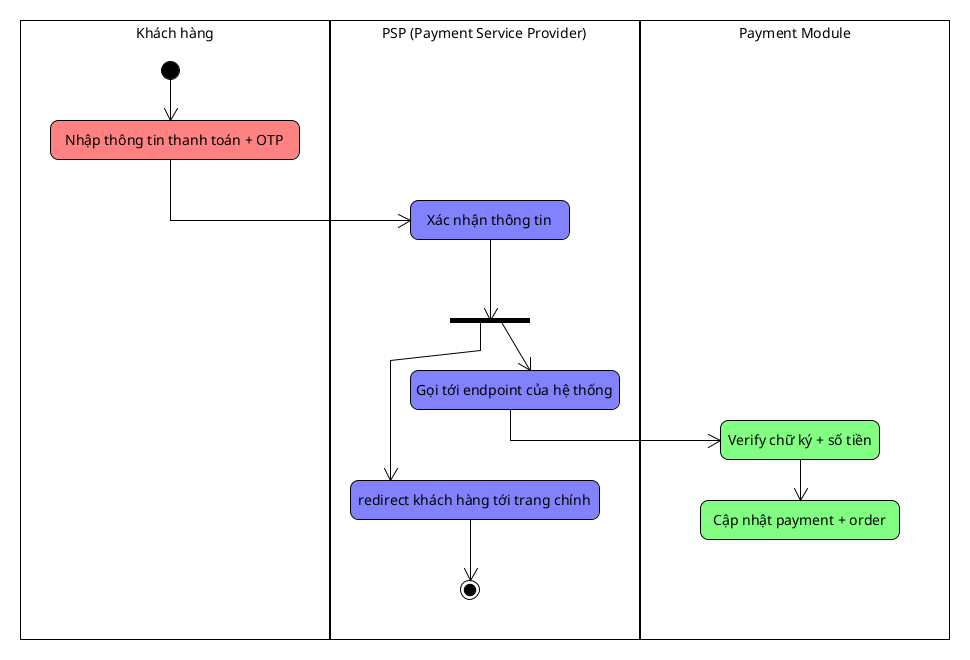
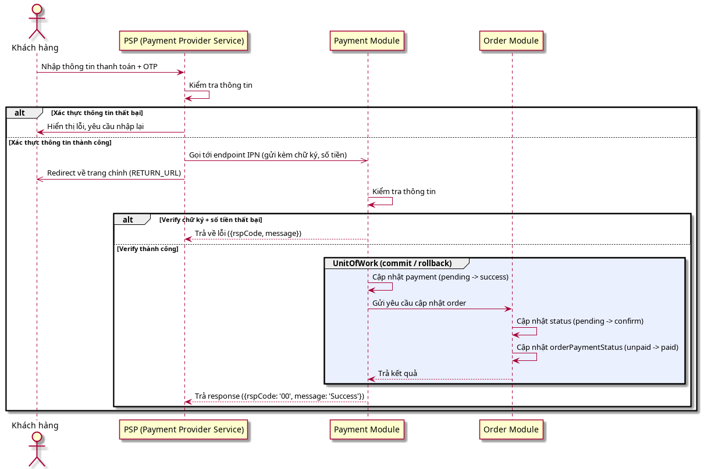

# Payment Lifecycle

Payment bắt đầu khi khách hàng thao tác trên trang của PSP và kết thúc khi
hệ thống nhận được kết quả xác thực (IPN) và cập nhật trạng thái.

Kết quả thanh toán trả về qua 2 kênh:
- **RETURN_URL** (browser): chỉ dùng để hiển thị cho khách, **không** dùng
  để cập nhật trạng thái.
- **IPN** (server → server): kênh chính để cập nhật trạng thái.

## Flow

Activity diagram mô tả happy path của payment flow

Khách hàng redirect sang trang của PSP -> Nhập thông tin thanh toán + OTP
-> PSP xác thực thông tin -> song song: (1) gọi IPN endpoint của hệ thống
(kèm số tiền, chữ ký), (2) redirect khách về trang chính (RETURN_URL)
-> Payment Module verify chữ ký + số tiền (chỉ tin IPN, không tin RETURN_URL)
-> verify thành công: cập nhật payment + order trong 1 UnitOfWork
-> trả rspCode cho PSP (`00` = success).

## Sequence diagram

Sequence diagram mô tả chi tiết interaction, gồm các nhánh verify fail và
cụm UnitOfWork bọc các update trong 1 transaction

## Trạng thái

- Payment: `pending` -> `success` | `failed` | `expired`
  - `failed`: PSP trả kết quả thất bại (sai OTP, thiếu tiền, user hủy)
  - `expired`: quá N phút không nhận IPN, hệ thống tự cắt
- Order: `pending` -> `confirm` | `failed`
- Order.orderPaymentStatus: `unpaid` -> `paid`

Trigger:
- Payment `success` -> payment `success` + order `confirm` +
  orderPaymentStatus `paid`, cả 3 cập nhật commit trong cùng 1
  UnitOfWork. Bất kỳ cập nhật nào lỗi -> rollback toàn bộ.
- Payment `failed` hoặc `expired` -> order `failed`
- Rollback khi cập nhật lỗi -> payment giữ `pending` (chờ xử lý lại)

## Edge case

- IPN gửi lại nhiều lần: chỉ xử lý 1 lần (idempotency) — kiểm tra
  transaction_ref trước khi cập nhật
- User đóng trình duyệt giữa chừng: không ảnh hưởng, IPN vẫn về nên
  payment vẫn chuyển `success`
- Quá N phút chưa nhận IPN: chủ động query API của PSP
- IPN `success` về sau khi payment đã `expired`: tôn trọng IPN (tiền thật
  đã di chuyển) -> chuyển `success`, log cảnh báo
- Verify chữ ký hoặc số tiền thất bại: bỏ qua, trả rspCode lỗi cho PSP,
  không cập nhật gì
